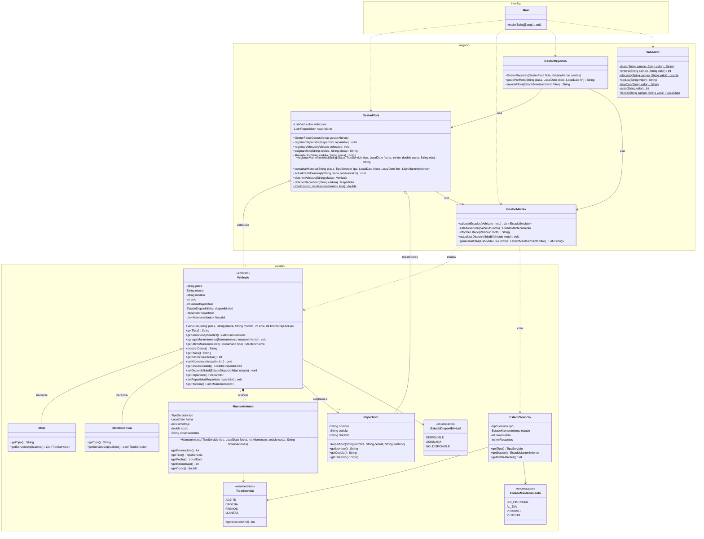

# SistemaMotos

Sistema de Control de Mantenimiento para Motos de Reparto (ISWZ1103 - Programación II).

Proyecto desarrollado por:

- José Parreño
- Andy Pulupa
- Mateo Quinatoa
- David Toapanta

Aplicación de consola en Java que controla el kilometraje de las motos, calcula cuándo toca cada
mantenimiento (aceite, cadena, frenos y llantas), genera alertas, bloquea las motos con mantenimiento
vencido y reporta el gasto de la flota.

## Requerimientos funcionales

| Módulo | RF | Dónde está | Opción del menú |
|---|---|---|---|
| 1. Motos y repartidores | RF1 Registrar repartidor y moto | `GestorFlota.registrarRepartidor / registrarVehiculo` + `Validador` | 1 y 2 |
| 1. Motos y repartidores | RF2 Asignar / liberar moto | `GestorFlota.asignarMoto / liberarMoto` | 3 |
| 2. Mantenimientos | RF3 Registrar mantenimiento | `GestorFlota.registrarMantenimiento` | 4 |
| 2. Mantenimientos | RF4 Consultar historial | `GestorFlota.consultarHistorial` | 5 |
| 3. Alertas y estado | RF5 Calcular estado | `GestorAlertas.calcularEstados / estadoGeneral` | 6 |
| 3. Alertas y estado | RF6 Alertas y bloqueo | `GestorAlertas.generarAlertas / actualizarDisponibilidad` | 7 |
| 4. Reportes | RF7 Gasto por moto | `GestorReportes.gastoPorMoto` | 8 |
| 4. Reportes | RF8 Reporte de la flota | `GestorReportes.reporteFlota` | 9 |

Reglas de negocio principales: intervalos aceite 3.000 km, cadena 6.000 km, frenos 8.000 km, llantas 15.000 km.
Estado de un servicio: **Vencido** si superó el km, **Próximo a vencer** si resta el 10 % o menos del intervalo,
**Al día** en otro caso; el estado general de la moto es el más crítico. Una moto vencida pasa a
**No disponible** y se libera al registrar su mantenimiento.

## Estructura (paquetes)

| Paquete | Clase | Función |
|---|---|---|
| modelo | `Vehiculo` (abstracta) | Clase padre: datos de la moto, historial, repartidor y disponibilidad |
| modelo | `Moto` | Hija de `Vehiculo`: aplican los 4 servicios |
| modelo | `MotoElectrica` | Hija de `Vehiculo`: no aplica aceite |
| modelo | `Repartidor` | Nombre, cédula y teléfono |
| modelo | `Mantenimiento` | Servicio realizado (tipo, fecha, km, costo, observaciones) y su próximo km |
| modelo | `EstadoServicio` | Resultado del cálculo de estado de un servicio (RF5) |
| modelo | `TipoServicio`, `EstadoMantenimiento`, `EstadoDisponibilidad` | Enumeraciones |
| negocio | `GestorFlota` | RF1 a RF4: registros, asignación, mantenimientos e historial |
| negocio | `GestorAlertas` | RF5 y RF6: estados, alertas y bloqueos |
| negocio | `GestorReportes` | RF7 y RF8: gasto y reporte de la flota |
| negocio | `Validador` | Validaciones de campos vacíos, números, cédula, teléfono y fechas |
| interfaz | `Main` | Menú de consola (carga datos de ejemplo al iniciar) |

## POO aplicada

- **Encapsulamiento:** atributos privados con getters/setters; las listas se devuelven como no modificables.
- **Herencia:** `Moto` y `MotoElectrica` extienden `Vehiculo`.
- **Polimorfismo:** `getServiciosAplicables()` devuelve una lista distinta según el tipo de moto, y el resto
  del sistema (estados, alertas, reportes) funciona igual con cualquier `Vehiculo`.

## Ejecutar

Requiere JDK 11 o superior (también funciona abriendo la carpeta en IntelliJ IDEA).

```
javac -encoding UTF-8 -d out modelo/*.java negocio/*.java interfaz/*.java
java -Dstdout.encoding=UTF-8 -cp out interfaz.Main
```

Datos de ejemplo al iniciar: `ABC-123` (próxima a vencer, asignada a Juan Pérez), `XYZ-789` (frenos vencidos,
bloqueada, de María López), `ELE-001` (eléctrica, al día) y `NEW-001` (sin historial).
Cédulas de ejemplo: `1712345678` y `1723456789`.

## Casos de prueba sugeridos (con los datos de ejemplo)

| ID | RF | Entrada | Resultado esperado |
|---|---|---|---|
| CP1 | RF1 | Registrar moto con placa `ABC-123` | Error: ya existe una moto con esa placa |
| CP2 | RF1 | Registrar moto con kilometraje `-5` | Error: el kilometraje no puede ser negativo |
| CP3 | RF1 | Registrar repartidor con cédula `123` | Error: la cédula debe tener 10 dígitos |
| CP4 | RF2 | Asignar `XYZ-789` a `1712345678` | Error: mantenimiento vencido |
| CP5 | RF2 | Asignar `ABC-123` a `1723456789` | Error: la moto ya está asignada |
| CP6 | RF3 | Moto `ELE-001`, aceite | Error: el servicio no aplica a una moto eléctrica |
| CP7 | RF3 | Moto `XYZ-789`, frenos, km `10500`, costo `45` | "Próximo frenos a los 18500 km." y la moto se libera |
| CP8 | RF3 | Km menor al actual, fecha futura o costo negativo | Error correspondiente |
| CP9 | RF4 | Fecha inicial `2026-12-31`, final `2026-01-01` | Error: fecha inicial posterior a la final |
| CP10 | RF5 | Placa `ABC-123` | Aceite "Próximo a vencer", restan 200 km, estado PRÓXIMA A VENCER |
| CP11 | RF6 | Opción 7 sin filtro | Alerta crítica de `XYZ-789` y aviso de `ABC-123` |
| CP12 | RF7 | `XYZ-789`, 2026-01-01 a 2026-12-31 (tras CP7) | Total USD 85.00 y costo por km USD 0.0100 |
| CP13 | RF7 | `NEW-001`, cualquier periodo | "Sin gastos en el periodo." |
| CP14 | RF8 | Opción 9 sin filtro | Porcentajes por estado, ranking, repartidores afectados y gasto total |

## Diagrama UML

El mismo código está en `diagrama.mmd` para pegarlo en [mermaid.live](https://mermaid.live).


